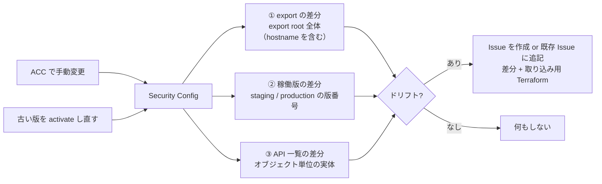

# appsec-driftguard

Akamai **App & API Protector**（AppSec / WAF）の Security Configuration を Terraform で
管理していると、Akamai Control Center（以下 ACC）から手作業で設定が変わることがあります
（攻撃対応の緊急変更、サポート作業など）。すると Terraform が把握している状態と実体がズレます。
これを **ドリフト（drift）** と呼びます。

**appsec-driftguard** は、そのドリフトを GitHub Actions で検知し、
「何がどう変わったか」と「それを Terraform に取り込むためのサンプルコード」を
**Issue で通知**する仕組みです。Terraform を手動で運用しているチームでも、
プルリクエストや自動反映を前提にせず「気づいて、必要なら取り込む」だけで運用できます。

---

## 仕組み

設定の現況を3つの見方で baseline と比べ、ドリフトの検知と、取り込みコードの生成を分担させます。



**① 版の内容を比べる（export の差分）— 検知の主役**
`akamai terraform export-appsec` で現在の設定を HCL（Terraform の設定言語）として書き出し、リポジトリに保存した
基準（baseline）と比べます。export は決定的（同じ設定を2回書き出すと一致する）なので、
差分がそのまま「変わった箇所」になります。rate policy の値、ポリシーに割り当てた custom rule、
WAF mode、そして ACC で新しく作られた定義も、ここに出ます。

比べるのは **export root 全体**（`.tf` / `.tf.json` を再帰）です。`modules/security/` だけに絞ると、
**保護対象ホストの一覧の増減を取りこぼします**。ホスト名の実値は root の `appsec-variables.tf` に
しかなく、`modules/security/main.tf` は `host_names = var.hostnames` と参照しているだけなので、
ホストを1本外しても `modules/security/` は変化しないためです。除外するのは `appsec-main.tf` だけで、
provider ブロックに export した端末の `.edgerc` の絶対パスが入るためです（比較に含めると CI と
手元で永久に食い違います）。

**② 稼働版を比べる（staging / production に載っている版番号）**
baseline を作った時点で staging / production に載っていた version 番号を `baseline/objects.json` に
記録し、毎回それと突き合わせます。**ACC で何も編集せず、古い版を activate し直すだけ**の操作は、
設定の中身が一切変わらないので ① にも ③ にも現れません。それでも実際に効いている保護は古い版の
内容に戻ります。**設定の中身は baseline と一致したまま、防御だけが弱くなる**状態を拾うために、
稼働版を独立した基準として持ちます。
`baseline/objects.json` に稼働版の記録が無い（このテンプレートの以前の形式で作った）場合、検知は
clean 扱いにせず**異常終了します**。「見ていないのに緑」を作らないためです。下の「既に baseline を
運用している場合」を参照してください。

**③ config レベルのオブジェクト一覧を比べる（API の差分）— 取り込みコードの材料**
custom rules / rate policies の一覧を API で取得し、baseline と比べます。
一覧 API は概要しか返さないので、各ルールを個別に取得して conditions まで突き合わせます。

③は①の取りこぼしを埋めるためのものではありません（未割り当ての custom rule の追加・変更も、
実測では①の差分に出ました）。③の役割は、差分を**オブジェクト単位で構造化して持つ**ことです。
export の差分はテキストなので「custom rule が1つ増えた、id はこれ、中身はこれ」という形では
取り出せません。API から実体を取っておくことで、Issue に載せる `resource` ブロックと
`terraform import` コマンドを自動生成できます。

なお `terraform plan` は state にあるものしか見ないため、ACC 側で新しく作られたオブジェクトは
plan には現れません。だから検知は Terraform の外に置いています。

---

## 通知される Issue

ドリフトを検知すると、次の内容の Issue が自動で立ちます。

- 何がどう変わったかの差分
- staging / production に載っている版が入れ替わっていれば、その版番号
- 取り込み用のサンプル `resource` ブロック（`jsonencode` 込み）と `terraform import` コマンド

3つ目が出るのは **custom rule と rate policy の追加・変更のとき**だけです。WAF mode や
security policy、match target、advanced settings の変更は、差分としては出ますが取り込み用の
コードは付きません（該当する resource を手元の `.tf` で直してください）。

読んだ人が、採用するならサンプルを `.tf` に反映して `terraform apply`、
不要なら ACC 側を元に戻します。落ち着いたら baseline を更新して Issue を閉じます。

---

## 前提

- **Akamai CLI**（本体）＋プラグイン `appsec` / `terraform`
  （検知ワークフローは CI 内で自動導入します。**CLI 本体・プラグイン・Terraform はすべて版を固定**しています。
  プラグインを `akamai install`（＝常に最新）任せにすると export 出力が変わって baseline と食い違い、
  偽ドリフトを招くため。版は `drift-detect.yml` の `CLI_VER` / `TF_PLUGIN_VER` / `APPSEC_PLUGIN_VER` で管理します）
- **Terraform**（`terraform fmt -recursive` / 反映で使用。baseline と検知で同じ整形を掛けるため、
  手元と CI で同じ版を使ってください）
- **Python 3**
- **`.edgerc`** に `[default]` セクション（このテンプレートは section=`default` を前提。
  別名にする場合はワークフローと baseline 作成コマンドの section を合わせてください）

## 始める前に（この2つは後から取り返しがつきません）

### 1. リポジトリは必ず private に。Fork は使わない

**Fork したリポジトリは、後から private に変更できません**（GitHub の仕様）。
"Use this template" で **Private** を選ぶか、clone して自分の private リポジトリへ push してください。

private が要る理由は、ドリフト Issue に WAF ルールが載ることだけではありません。
**より大きいのは baseline の commit のほう**です。下のクイックスタート 3 で commit するのは、

- 全 custom rule の conditions（＝WAF の検知ロジックそのもの）
- match target / WAF mode / rate policy の閾値 / penalty box / bot 設定 一式
- **保護対象ホストの全リスト**
- 通知先のメールアドレス
- `appsec-main.tf` に焼き込まれた、export した端末の `.edgerc` の絶対パス

です。しかも baseline の commit は**ワークフローが1回も走る前**に行うので、ワークフロー側で
どんなガードを入れても間に合いません。可視性はここで決めてください。

### 2. `.edgerc` は READ-ONLY のものを使う

検知ワークフローが使うのは `export-appsec` と `appsec` の GET だけで、**書き込み権限は要りません**。
ACC で **AppSec の READ-ONLY** グラントだけを持つ API クライアントを新しく作り、その資格情報を
Secret に入れてください。事故が起きたときの被害が「WAF 設定を読まれる」で止まります。

**`~/.edgerc` を丸ごと貼らないでください。** 多くの人の `~/.edgerc` には papi 用や別アカウント用の
セクションが同居していて、貼るとそれも全部 runner に載ります。Secret に入れるのは、CI 用に作った
資格情報の `[default]` セクション**だけ**にしてください。

書き込み権限が要るのは `apply.yml`（反映）と `tests/live_integration.sh`（結合テスト）だけです。
これらを使うなら、検知用とは**別の**資格情報を用意し、Environment シークレットに分けるのが安全です。

---

## クイックスタート

1. このリポジトリを、**自分の private なリポジトリ**にコピーします（上の「始める前に」を参照）。

2. GitHub のリポジトリ設定で次を登録します。

   | 種別 | 名前 | 内容 |
   |---|---|---|
   | Secret | `EDGERC` | CI 用に作った READ-ONLY 資格情報の `.edgerc`（`[default]` セクションのみ） |
   | Variable | `APPSEC_CONFIG_NAME` | 対象 Security Config の名前 |
   | Variable | `APPSEC_CONFIG_ID` | 対象 Security Config の ID |

3. 検知の基準（baseline）を作って commit します。

   ```bash
   # 版の内容（HCL）と、config レベルのオブジェクト一覧＋稼働版を baseline に保存する
   mkdir -p ./baseline                               # export 先は先に作る（無いと失敗する）
   akamai terraform --section default export-appsec --tfworkpath ./baseline "<config 名>"
   terraform fmt -recursive ./baseline               # 検知側と同じ整形（-recursive を外さない）
   python3 lib/make_baseline.py <config id>          # → baseline/objects.json（稼働版も記録）
   git add -f baseline && git commit -m "add baseline"
   ```

   **この baseline は、CI と同じ版のツールで作ってください。** ワークフローは Akamai CLI ・
   プラグイン・Terraform の版を固定していますが（`drift-detect.yml` の `CLI_VER` /
   `TF_PLUGIN_VER` / `APPSEC_PLUGIN_VER`、`setup-terraform` の `terraform_version`）、
   手元がそれと違う版だと export の出力が食い違い、初回から偽のドリフトが出続けます。
   手元の版は `akamai --version` / `akamai terraform --version` / `terraform version` で確認できます。

   `baseline/` は `.gitignore` 済みです（実データを誤って公開しないため）。
   自分の private リポジトリで運用するときだけ、`-f` を付けて意図的に commit します。
   **後で baseline を更新するときも、毎回 `-f` が要ります。** `.gitignore` 済みなので、
   `-f` 無しだと**新しく現れたファイルが黙って無視されます**（`git status` にも出ません）。
   プラグインを上げて生成ファイルが1本増えたときなどに、baseline にだけそれが無い状態になり、
   永久にドリフトが出続けます。

   **`baseline/` は検知の基準であって、運用する Terraform 構成ではありません。** ここで
   `terraform init` / `apply` を始めないでください。次に baseline を作り直したときに上書き
   されます。反映用の `.tf` は別のディレクトリで管理してください（`contract_id` / `group_name`
   を手入力する必要があるのもそちら側で、baseline では空のままで構いません）。

   **baseline を作らずにワークフローを回すと、検知は clean 扱いせず異常終了（赤）します**
   （設定ミスを見逃さないための挙動）。必ず先に baseline を commit してください。

4. Actions の **appsec-drift-detect** を手動で実行して、緑になることを確認します。
   ドリフトがあれば Issue が立ちます。無ければ何もしません。

5. 定期実行を有効にします。このテンプレートは `schedule` をコメントアウトした状態で配っています
   （baseline を commit する前に定期実行が回ると、毎時赤くなるため）。
   4 が緑になったら `.github/workflows/drift-detect.yml` の `schedule:` のコメントを外してください。

### 既に baseline を作って運用している場合（移行）

検知は **export root 全体**を比べるようになり、**稼働版**も基準に加わりました。以前のバージョンで
作った baseline のままだと、次の2つが起きます。

- `baseline/objects.json` に稼働版の記録が無いため、検知が clean 扱いにせず**異常終了（赤）**します。
- baseline の root にある `.tf`（`appsec-variables.tf` など）が未整形のままだと、内容が同じでも
  差分として出ます。

この順で移行してください。

1. **先に、いま動いているバージョンのまま検知を1回実行し、緑（ドリフトなし）を確認します。**
   未対応のドリフトが残ったまま先に進むと、それが新しい基準として取り込まれてしまいます。
2. コードを更新します。
3. baseline を整形し直し、オブジェクト一覧と稼働版を作り直します。**再 export はしません**
   （再 export すると、いまの状態がそのまま新しい基準になり、内容のドリフトが消えます）。

   ```bash
   terraform fmt -recursive ./baseline
   python3 lib/make_baseline.py <config id>      # objects.json を作り直す（稼働版を含む）
   git add -f baseline && git commit -m "migrate baseline: recursive fmt + activation"
   ```

4. 検知を手動実行し、緑になることを確認します。ここで差分が出たなら、それは走査範囲が広がったことで
   **新しく見えるようになったドリフト**です（保護対象ホストの増減など）。Issue の手順で片づけてから、
   改めて baseline を更新してください。

---

## 含まれるもの

| パス | 役割 |
|---|---|
| `lib/detect.py` | 検知の本体（版の内容 / 稼働版 / オブジェクト一覧の3段の差分判定） |
| `lib/adopt.py` | 検知結果を Issue 本文（差分＋取り込み用 Terraform）に変換 |
| `lib/make_baseline.py` | baseline の `objects.json`（オブジェクト一覧＋稼働版）を作るヘルパー |
| `.github/workflows/drift-detect.yml` | 検知して Issue を立てるワークフロー |
| `.github/workflows/apply.yml` | Terraform を反映するワークフロー（任意・下記参照） |
| `terraform/drift-gate.tf` | 反映前に「稼働版が想定どおりか」を確認する例 |
| `tests/` | 単体テストと、実 config に対する結合テスト |

`apply.yml` と `terraform/drift-gate.tf` は、承認付きで Terraform を反映したいチーム向けの
**雛形で、このままでは動きません**（Terraform の構成一式がこのリポジトリに無いため）。
使う場合は自分の `.tf` 一式を置き、gate ジョブに Akamai CLI の導入ステップを足し、
GitHub の Environments（staging / production の承認者）を用意してください。
本番反映は影響が大きいため、承認を必須にすることを前提にしています。
検知だけを使うなら、この2つは消して構いません。

---

## テスト

```bash
python3 tests/test_detect.py     # 検知ロジック
python3 tests/test_adopt.py      # Issue / Terraform 生成
```

実 config に対する結合テスト（可逆・実行後に自動で後片付け）:

```bash
CONFIG_NAME="<config 名>" CONFIG_ID="<config id>" bash tests/live_integration.sh
```

このテストは**実際の config に書き込みます**（一時的な custom rule の作成、version の clone、
rate policy の変更）。実行後に自身で後片付けしますが、**書き込み権限のある `.edgerc`**（＝検知用の
READ-ONLY とは別のもの）と `jq` が必要です。**本番の config では実行しないでください。**
また、後片付けはローカルには及びません。`tests/live_baseline/` に実 config の完全な export が
残るので、実行後に消してください（`.gitignore` 済みなので commit はされません）。

---

## 知っておくべきこと

- **ドリフト Issue にも baseline にも設定の中身（WAF ルール・保護対象ホスト等）が入ります。**
  運用リポジトリは必ず private に（上の「始める前に」を参照）。この公開テンプレートには実データを
  含めていません（`baseline/` は `.gitignore` 済み）。
- ACC 側で新しく作られたオブジェクトは、`terraform plan` には現れません（state に無いため）。
  その分は Issue にサンプルコードと `import` コマンドを添えます。
- Akamai の version は、いちど有効化すると編集できません。変更は新しい version を作って行います。
  反映する version を `latest_version` に任せず明示するのが安全です（外部で作られた版まで拾わないため）。
- 検知は cron 周期で走るので、変更から通知までにラグがあります。
- **ワークフローが失敗（赤）したときの通知を設定してください。** 認証情報の失効、config 名の変更、
  baseline の不整合はいずれも異常終了（exit 3）で、**Issue は立ちません**。GitHub の cron 失敗通知は
  既定だとワークフローを最後に更新した人にしか飛ばないので、放置すると「毎時走っているから安心」と
  思ったまま監視が死にます。ドリフトそのものより、監視が止まることのほうが危険です。
- **cron の頻度は config の規模に合わせてください。** 1 回の実行で CLI とプラグインの導入 ＋ config
  全体の再 export が走ります。さらに custom rule は**1本ずつ個別に API 取得**するので、ルールが
  100 本あれば毎時 100 回以上のリクエストになります。private リポジトリの Actions は課金対象でも
  あるので、ルール数の多い config では日次に落とすことも検討してください。
- **open な drift Issue が1件でも残っていると、新しい Issue は作りません**（毎時の重複を防ぐため）。
  ただし黙るわけではなく、**前と内容が変わったドリフトは既存の Issue にコメントで追記し、run にも
  `::warning::` の注釈を出します**（同じ内容が続く間だけ静かにします）。対応中に別の変更が入っても
  気づけるようにするためです。とはいえ通知の粒度は落ちるので、対応が済んだら Issue は閉じてください。
- **設定の中身が baseline と一致していても、staging / production に載っている版が入れ替わっていれば
  ドリフトとして検知します。** 古い版を activate し直すだけのロールバックは内容の差分に現れませんが、
  実際に効いている保護は弱くなります。Issue には「稼働版が変わっています」として版番号が出ます。
- **`baseline/objects.json` に稼働版の記録が無いと、検知は clean 扱いにせず異常終了します。**
  以前の形式で作った baseline が該当します。「既に baseline を作って運用している場合（移行）」を
  参照してください。
- **ドリフトが残ったまま Issue を閉じると、毎時新しい Issue が立ち続けます。** 重複の抑止は
  「open な Issue があるか」で見ているためです。閉じるのは、ACC 側を戻すか baseline を更新して
  ドリフトが解消してからにしてください。
- private リポジトリにコピー後、**Actions を有効化**し、ワークフローが Issue を作れるよう
  権限（`issues: write`。Org で GITHUB_TOKEN を read-only に絞っている場合は要確認）を整えてください。

---

## 設定

- 検知の頻度: `.github/workflows/drift-detect.yml` の `schedule` のコメントを外し、cron を変更。
  （配布時点ではコメントアウトしてあります。クイックスタート 5 を参照。）
- 対象 config: `APPSEC_CONFIG_NAME` / `APPSEC_CONFIG_ID`（Variable）。
- 認証: `EDGERC`（Secret）。検知は READ-ONLY で足ります（上の「始める前に」を参照）。
