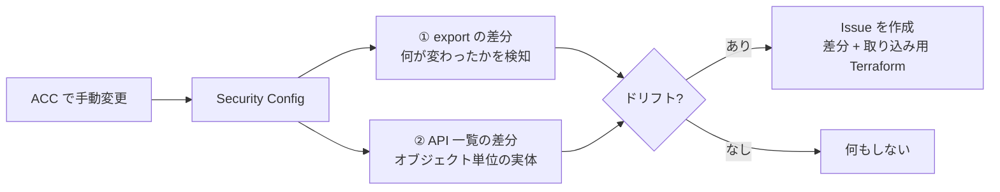

# appsec-driftguard

Akamai **App & API Protector**（AppSec / WAF）の Security Configuration を Terraform で
管理していると、Akamai Control Center（以下 ACC）から手作業で設定が変わることがあります
（攻撃対応の緊急変更、サポート作業など）。すると Terraform が把握している状態と実体がズレます。
これを **ドリフト（drift）** と呼びます。

**appsec-driftguard** は、そのドリフトを GitHub Actions で検知し、
「何がどう変わったか」と「それを Terraform に取り込むためのサンプルコード」を
**Issue で通知**する仕組みです。Terraform を手動で運用しているチームでも、
プルリクエストや自動反映を前提にせず「気づいて、必要なら取り込む」だけで運用できます。

---

## 仕組み

設定の現況を2つの見方で baseline と比べ、ドリフトの検知と、取り込みコードの生成を分担させます。



**① 版の内容を比べる（export の差分）— 検知の主役**
`akamai terraform export-appsec` で現在の設定を HCL（Terraform の設定言語）として書き出し、リポジトリに保存した
基準（baseline）と比べます。export は決定的（同じ設定を2回書き出すと一致する）なので、
差分がそのまま「変わった箇所」になります。rate policy の値、ポリシーに割り当てた custom rule、
WAF mode、そして ACC で新しく作られた定義も、ここに出ます。

**② config レベルのオブジェクト一覧を比べる（API の差分）— 取り込みコードの材料**
custom rules / rate policies の一覧を API で取得し、baseline と比べます。
一覧 API は概要しか返さないので、各ルールを個別に取得して conditions まで突き合わせます。

②は①の取りこぼしを埋めるためのものではありません（未割り当ての custom rule の追加・変更も、
実測では①の差分に出ました）。②の役割は、差分を**オブジェクト単位で構造化して持つ**ことです。
export の差分はテキストなので「custom rule が1つ増えた、id はこれ、中身はこれ」という形では
取り出せません。API から実体を取っておくことで、Issue に載せる `resource` ブロックと
`terraform import` コマンドを自動生成できます。

なお `terraform plan` は state にあるものしか見ないため、ACC 側で新しく作られたオブジェクトは
plan には現れません。だから検知は Terraform の外に置いています。

---

## 通知される Issue

ドリフトを検知すると、次の内容の Issue が自動で立ちます。

- 何がどう変わったかの差分
- それを手元の Terraform に取り込むためのサンプル `resource` ブロック（`jsonencode` 込み）
- 新規オブジェクトを Terraform の管理下に入れる `terraform import` コマンド

読んだ人が、採用するならサンプルを `.tf` に反映して `terraform apply`、
不要なら ACC 側を元に戻します。落ち着いたら baseline を更新して Issue を閉じます。

---

## 前提

- **Akamai CLI**（本体）＋プラグイン `appsec` / `terraform`
  （検知ワークフローは CI 内で自動導入します。**CLI 本体・プラグイン・Terraform はすべて版を固定**しています。
  プラグインを `akamai install`（＝常に最新）任せにすると export 出力が変わって baseline と食い違い、
  偽ドリフトを招くため。版は `drift-detect.yml` の `CLI_VER` / `TF_PLUGIN_VER` / `APPSEC_PLUGIN_VER` で管理します）
- **Terraform**（`terraform fmt` / 反映で使用）
- **Python 3**
- **`.edgerc`** に `[default]` セクション（このテンプレートは section=`default` を前提。
  別名にする場合はワークフローと baseline 作成コマンドの section を合わせてください）

## クイックスタート

1. このリポジトリを、**自分の private なリポジトリ**にコピーします。
   （ドリフト Issue には設定の中身が載るため、運用リポジトリは private にしてください。）

2. GitHub のリポジトリ設定で次を登録します。

   | 種別 | 名前 | 内容 |
   |---|---|---|
   | Secret | `EDGERC` | Akamai の `.edgerc`（API 認証情報） |
   | Variable | `APPSEC_CONFIG_NAME` | 対象 Security Config の名前 |
   | Variable | `APPSEC_CONFIG_ID` | 対象 Security Config の ID |

3. 検知の基準（baseline）を作って commit します。

   ```bash
   # 版の内容（HCL）と、config レベルのオブジェクト一覧の2つを baseline に保存する
   mkdir -p ./baseline                               # export 先は先に作る（無いと失敗する）
   akamai terraform --section default export-appsec --tfworkpath ./baseline "<config 名>"
   terraform fmt ./baseline/modules/security
   python3 lib/make_baseline.py <config id>          # → baseline/objects.json
   git add -f baseline && git commit -m "add baseline"
   ```

   **この baseline は、CI と同じ版のツールで作ってください。** ワークフローは Akamai CLI ・
   プラグイン・Terraform の版を固定していますが（`drift-detect.yml` の `CLI_VER` /
   `TF_PLUGIN_VER` / `APPSEC_PLUGIN_VER`、`setup-terraform` の `terraform_version`）、
   手元がそれと違う版だと export の出力が食い違い、初回から偽のドリフトが出続けます。
   手元の版は `akamai --version` / `akamai terraform --version` / `terraform version` で確認できます。

   `baseline/` は `.gitignore` 済みです（実データを誤って公開しないため）。
   自分の private リポジトリで運用するときだけ、`-f` を付けて意図的に commit します。
   **baseline を作らずにワークフローを回すと、検知は clean 扱いせず異常終了（赤）します**
   （設定ミスを見逃さないための挙動）。必ず先に baseline を commit してください。

4. Actions の **appsec-drift-detect** を手動で実行して、緑になることを確認します。
   ドリフトがあれば Issue が立ちます。無ければ何もしません。

5. 定期実行を有効にします。このテンプレートは `schedule` をコメントアウトした状態で配っています
   （baseline を commit する前に定期実行が回ると、毎時赤くなるため）。
   4 が緑になったら `.github/workflows/drift-detect.yml` の `schedule:` のコメントを外してください。

---

## 含まれるもの

| パス | 役割 |
|---|---|
| `lib/detect.py` | 検知の本体（2段の差分判定） |
| `lib/adopt.py` | 検知結果を Issue 本文（差分＋取り込み用 Terraform）に変換 |
| `lib/make_baseline.py` | baseline の `objects.json` を作るヘルパー |
| `.github/workflows/drift-detect.yml` | 検知して Issue を立てるワークフロー |
| `.github/workflows/apply.yml` | Terraform を反映するワークフロー（任意・下記参照） |
| `terraform/drift-gate.tf` | 反映前に「稼働版が想定どおりか」を確認する例 |
| `tests/` | 単体テストと、実 config に対する結合テスト |

`apply.yml` と `terraform/drift-gate.tf` は、承認付きで Terraform を反映したいチーム向けの
**雛形で、このままでは動きません**（Terraform の構成一式がこのリポジトリに無いため）。
使う場合は自分の `.tf` 一式を置き、gate ジョブに Akamai CLI の導入ステップを足し、
GitHub の Environments（staging / production の承認者）を用意してください。
本番反映は影響が大きいため、承認を必須にすることを前提にしています。
検知だけを使うなら、この2つは消して構いません。

---

## テスト

```bash
python3 tests/test_detect.py     # 検知ロジック
python3 tests/test_adopt.py      # Issue / Terraform 生成
```

実 config に対する結合テスト（可逆・実行後に自動で後片付け）:

```bash
CONFIG_NAME="<config 名>" CONFIG_ID="<config id>" bash tests/live_integration.sh
```

このテストは**実際の config に書き込みます**（一時的な custom rule の作成、version の clone、
rate policy の変更）。実行後に自身で後片付けしますが、書き込み権限のある `.edgerc` と
`jq` が必要です。本番の config では実行しないでください。

---

## 知っておくべきこと

- **ドリフト Issue には設定の中身（WAF ルール等）が載ります。** 運用リポジトリは必ず private に。
  この公開テンプレートには実データを含めていません（`baseline/` は `.gitignore` 済み）。
- ACC 側で新しく作られたオブジェクトは、`terraform plan` には現れません（state に無いため）。
  その分は Issue にサンプルコードと `import` コマンドを添えます。
- Akamai の version は、いちど有効化すると編集できません。変更は新しい version を作って行います。
  反映する version を `latest_version` に任せず明示するのが安全です（外部で作られた版まで拾わないため）。
- 検知は cron 周期で走るので、変更から通知までにラグがあります。
- **open な drift Issue が1件でも残っていると、次のドリフトは新しい Issue を作りません**
  （毎時の重複を防ぐため）。対応が済んだら Issue を閉じてください。閉じ忘れると通知が止まります。
- private リポジトリにコピー後、**Actions を有効化**し、ワークフローが Issue を作れるよう
  権限（`issues: write`。Org で GITHUB_TOKEN を read-only に絞っている場合は要確認）を整えてください。

---

## 設定

- 検知の頻度: `.github/workflows/drift-detect.yml` の `schedule` のコメントを外し、cron を変更。
  （配布時点ではコメントアウトしてあります。クイックスタート 5 を参照。）
- 対象 config: `APPSEC_CONFIG_NAME` / `APPSEC_CONFIG_ID`（Variable）。
- 認証: `EDGERC`（Secret）。最小権限のクレデンシャルを推奨します。
